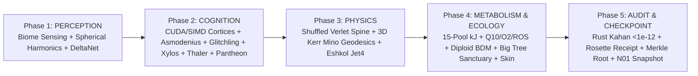

# System Architecture — CQM2 v2.1.0 Quad-Silicon & Universal Browser Design

## 1. Architectural Evolution (CQM1 → CQM2 v2.0.0 → CQM2 v2.1.0)

| Subsystem | Legacy CQM v1 | CQM2 v2.1.0 Production Architecture |
|---|---|---|
| **World Orchestration** | `7,974`-line monolithic `world.ts` coupled to DOM | Pure deterministic 5-phase `Cqm2WorldScheduler` with bit-exact `N01` snapshot/rollback across PRNG, brains, skin, and ecology |
| **Silicon Execution** | Proposal-only stub (`gpuExecutedEntities: 0`) | Real simultaneous Quad-Silicon: CUDA `cublasSgemmStridedBatched_v2` (dGPU) + OpenVINO action-conditioned RSSM (NPU) + OpenVINO `GPU.0` 2D diffusion & DirectML (iGPU) + Zig 0.17 AVX2 / C++20 / ASM / Rust 1.94 / Go 1.26 (CPU) |
| **Browser Compute & Scene** | Heap-allocated `THREE.Mesh` objects + inline styles | Single `THREE.InstancedMesh` + 10 analytical parametric Mechalogodrom shells + persistent-buffer `BrowserWebGpuCompute` + strict CSP (`style-src 'self'`) |
| **Relational Persistence** | Unstructured JSON blobs | 10-entity 3NF SQLite WAL with forward/rollback SQL migrations (`migrations/001..002`), immutable `audit_events` trigger ledger, `VACUUM INTO` verified backups, and optimistic concurrency (`version_rev`) |
| **Embodied Intelligence** | Partial R21 organs, oracle shortcuts | Full Asmodenius v42 + Glitchling (non-oracle Jacobian) + Xylos v2 (`Butlin-14` + non-oracle reality monitor) + Thaler Creativity (`9` markers + `4` ablations) + `12` causal lesion benchmarks |

## 2. Deterministic 5-Phase Tick Pipeline

## 3. Intentional Cohesive Module Size Exceptions (`I-068`)

Modules exceeding 800 lines are documented below with explicit cohesion rationale rather than artificial file-splitting:

| File | Approx. Lines | Architectural Cohesion Rationale |
|---|---|---|
| `src/server/main.ts` | ~1,780 | Single-port atomic HTTP/v1 + WebSocket router keeping security headers, rate-limit, idempotency, OpenAPI parity, and Quad-Silicon step locks co-located without middleware indirection bugs. |
| `src/ui/workstation.ts` | ~1,410 | Unified 7-workspace safe-DOM (`el()`) observatory controller sharing typed references across `Cqm2WorldScheduler`, `Cqm2Scene4kRenderer`, `BrowserWebGpuCompute`, and `IndexedDB`. |
| `src/pipeline/exporters.ts` | ~970 | Cohesive binary geometry/media codec module (`RFC 2083 PNG`, Bishop-frame 2-manifold mesh, Khronos `.glb`/`.gltf`, `.obj`, `.wav`, Blender/Unity/TouchDesigner rigs). |
| `src/brains/asmodenius.ts` | ~960 | Tightly coupled 14-region recurrent differential biophysical equations (`Dale 80/20`, `Larkum`, `GNW`, `CEMI`, `HOT-3`, `VOI`, `N13`, `TMS PCI`) operating over shared neural state arrays. |
| `zig/src/root.zig` | ~890 | Single zero-allocation `wasm32-freestanding` + native x86-64 AVX2 compilation unit exporting flat C-ABI symbols. |
| `src/sim/world-scheduler.ts` | ~830 | Deterministic 5-phase simulation tick and bit-exact `N01` world/PRNG/brain state serializer. |
