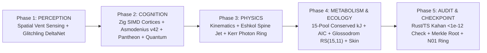

# System Architecture — CQM2 Full-Stack & Universal Browser Design

## 1. Architectural Motivation (CQM1 → CQM2 Refactor)

| Legacy CQM v1 Bottleneck | CQM2 v2.0.0 Engineered Replacement |
|---|---|
| `src/world.ts` 7,974-line monolithic God-object | Modular 5-phase `Cqm2WorldScheduler` (`src/sim/world-scheduler.ts`) with zero DOM/Three.js coupling |
| Proposal-only `hybrid-compute.ts` (`gpuExecutedEntities: 0`, `npuExecutedEntities: 0`) | Live physical `TriEngineOrchestrator` (`CUDA cuBLAS` + `OpenVINO NPU` + `DirectML iGPU` + `Zig SIMD128` + `Rust FFI`) |
| 50,000 heap-allocated `THREE.Mesh` objects causing GC stalls | Single `THREE.InstancedMesh` reading directly from flat `SharedArrayBuffer` SoA columns |
| `11.5+ MB` duplicated bundle with inlined SVG strings & `!important` CSS | `653.7 KB` minified ESM bundle + `9.5 KB` zero-`!important` token CSS |

## 2. Deterministic 5-Phase Tick Pipeline

## 3. Dual Deployment Topology

1. **Local Tri-Engine Workstation Mode (`bun run start` on `127.0.0.1:4200`)**:
   - Serves hardened `COOP/COEP` (`SharedArrayBuffer`-enabled) HTTP + WebSocket streams.
   - Dispatches heavy matrix/latent/audit workloads to `native/bin/cqm2_tri_accel.dll` (`RTX 5070 Ti`), `python/npu_world_worker.py` (`Intel AI Boost NPU`), and `native/bin/cqm2_rust_ledger.dll`, persisting ACID checkpoints into `data/cqm2_local.sqlite` (`WAL`).
2. **Universal Browser Standalone Mode (`site/` / GitHub Pages)**:
   - Runs the exact same TypeScript domain modules + embedded `8.8 KB` `cqm2_zig.wasm` SIMD128 kernel suite + `BrowserWebGpuCompute` (`WGSL`) 100% client-side on mobile, tablet, laptop, or 4K desktop with zero network dependencies.
